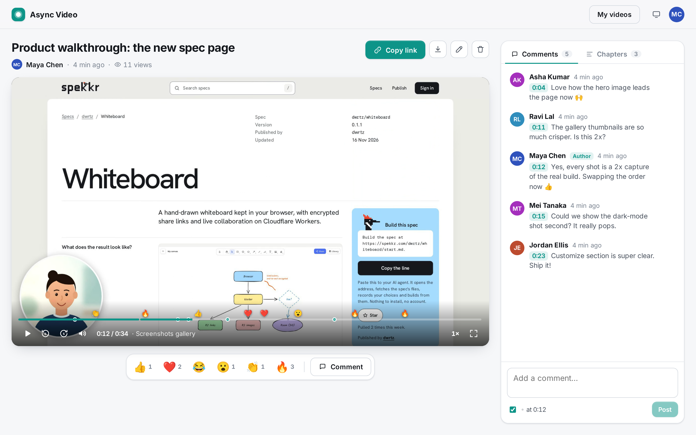
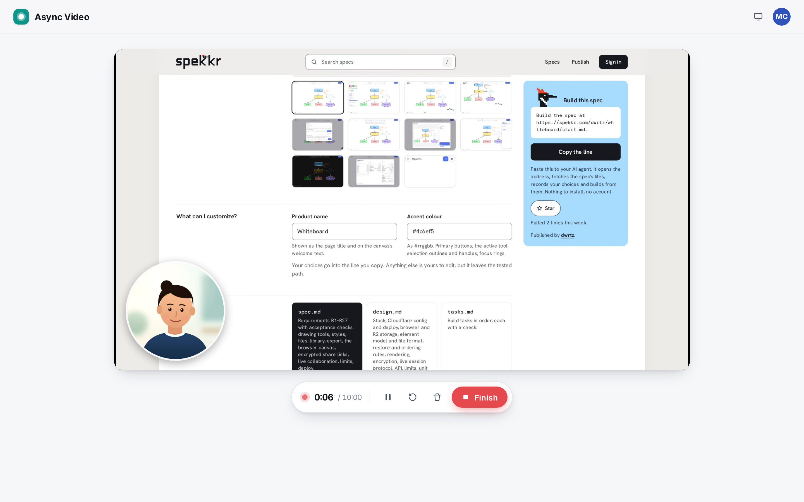

# Async Video

Record your screen and camera in the browser, share a link, and get comments and emoji reactions pinned to the exact moment. It runs as one Cloudflare Worker with R2 for the videos and D1 for everything else.

**Live demo:** https://video.beef-able.com (accounts are limited to the owner's email; share links are open to anyone who has them)



## Features

- **Recorder:**
  - screen + camera (the camera is a draggable, resizable bubble drawn into the video), screen only, or camera only
  - microphone on/off
  - 3-second countdown
  - pause, restart, cancel
  - up to 10 minutes
- **Upload:** in 5 MB parts straight to R2 (multipart, 3 at a time, retried) with a progress bar. WebM files get a proper duration so they're seekable.
- **Share page:**
  - player with speeds 0.75×–2.5× (showing the time at each speed), keyboard shortcuts, `?t=` links and chapters on the seek bar
  - timestamped comments, emoji reactions that float over the video and leave markers
  - view counts (once per viewer, never the owner)
- **Owner tools:** rename, trim (non-destructive), chapters, turn comments or downloads off, download, delete.
- **Everything else:** library with search, light/dark theme, and a phone layout (phones without screen capture record with the camera).



## What is stored where

| Data | Where |
|---|---|
| Video files `videos/<id>/video` and thumbnails `videos/<id>/thumb.jpg` | R2 bucket `video-media` (binding `MEDIA`) |
| Accounts, sessions (token hashes only), videos' metadata, comments, reactions, views | D1 database `video` (binding `DB`) |
| Theme, speed, recorder choices, viewer id, commenter name | the browser's `localStorage` |

**Share links are public.** Anyone with a video's link can watch it, comment and react, without an account. Ids are 12 random base62 characters, so links can't be guessed, but treat them like any unlisted link.

## Who can have an account

Set the comma-separated `ALLOWED_EMAILS` var in `wrangler.jsonc` (or in the dashboard under the Worker's Settings → Variables). The Worker checks it on sign-up, on sign-in and on every request that uses a session:

```jsonc
"vars": { "ALLOWED_EMAILS": "you@example.com", "STORAGE_LIMIT_MB": "5000" }
```

- Everyone else gets 403 "This site only accepts accounts for approved email addresses."
- Removing an email signs that account out at its next request.
- Leaving it empty lets anyone sign up.
- The app sends no email (no verification, no reset). **The allowlisted person creates their own account** by opening the site and choosing "Create account".

## Limits

| Limit | Value |
|---|---|
| Recording length | 10 minutes |
| File size | 500 MB (parts up to 10 MB) |
| Thumbnail | 1 MB JPEG |
| Title / comment / name | 120 / 2,000 / 60 characters |
| Chapters | 50 |
| Total storage | `STORAGE_LIMIT_MB` (default 5000), then new videos get 507 |
| Creating videos | 10 a minute per account (`CREATE_LIMIT`) |
| Comments, reactions, views | 60 a minute per IP (`WRITE_LIMIT`) |
| Sign-up / sign-in attempts | 10 a minute per IP (`AUTH_LIMIT`) |

Every write must come from the site's own origin. Cross-site requests get 403.

## Run locally

```sh
npm install
npm run dev          # builds, applies migrations to the local D1, runs wrangler dev on http://localhost:8787
```

Local dev needs no Cloudflare account. Recording needs a secure context, so use `localhost` (not a LAN IP). To try sign-up locally, put your email in `ALLOWED_EMAILS` or pass `--var ALLOWED_EMAILS:you@example.com` to `wrangler dev`.

## Test

```sh
npm run typecheck
npm test                          # Vitest unit tests
npx playwright install chromium
npm run e2e                       # Playwright: desktop + iPhone 13 + Pixel 7, against wrangler dev
```

The end-to-end tests use Chromium's fake camera, microphone and screen (`--use-fake-device-for-media-stream`, `--use-fake-ui-for-media-stream`, `--auto-select-desktop-capture-source=Entire screen`), so they make real recordings without hardware.

## Deploy

1. `npx wrangler login`
2. `npx wrangler d1 create video`, then put the printed id in `wrangler.jsonc` → `d1_databases[0].database_id`.
3. `npx wrangler r2 bucket create video-media`
4. Set `vars.ALLOWED_EMAILS` to the email(s) that may have accounts.
5. `npm run deploy` builds the client, applies D1 migrations remotely, and deploys the Worker with its assets.
6. Optional: add a custom domain (Workers → `video` → Settings → Domains & Routes), and turn off the `workers.dev` and preview URLs.
7. Open the site and create your account with the allowlisted email.

## Stack

TypeScript, Cloudflare Workers, R2, D1 and Workers Rate Limiting, React 18 + Vite, plus the browser's `getDisplayMedia`, `getUserMedia`, canvas, `MediaRecorder` and `AudioContext`. Tested with Vitest and Playwright. It uses [`fix-webm-duration`](https://github.com/yusitnikov/fix-webm-duration) (MIT) and the Inter font (OFL).

## License

MIT. See [LICENSE](LICENSE).
